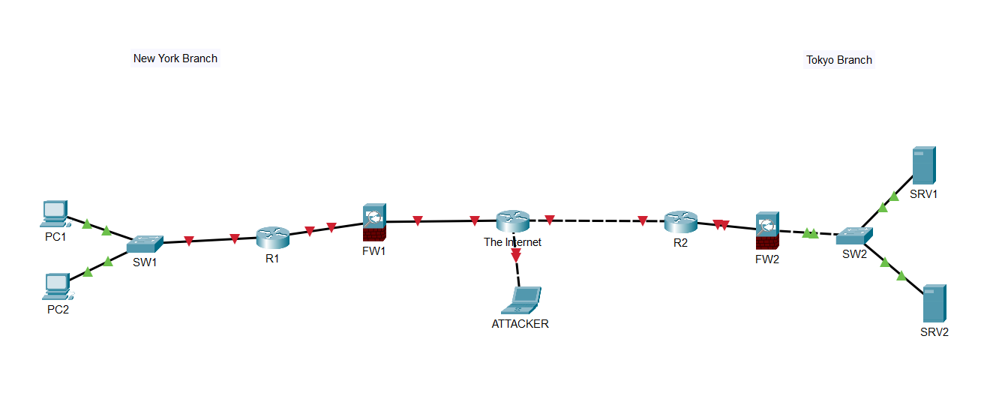

# Lab 01 - Packet Tracer Introduction

## Objective

Recreate the network diagram shown at **16:40 of the Day 1 video** to become familiar with placing and connecting devices in Cisco Packet Tracer.

## Topology

- **New York Branch:** PC1 and PC2 connect to SW1, followed by R1 and FW1 toward the Internet.
- **Tokyo Branch:** SRV1 and SRV2 connect to SW2, followed by FW2 and R2 toward the Internet.
- **Attacker:** a laptop connected to the device labeled "The Internet".

## Required Devices

| Device | Model | Quantity |
| --- | --- | --- |
| Router | Cisco 2911 | 2 |
| Switch | Cisco 2960 | 2 |
| Firewall | Cisco ASA 5505 | 2 |
| PC | PC | 2 |
| Server | Server | 2 |
| Attacker | Laptop | 1 |

The supplied topology screenshot also includes a central device labeled **The Internet**, represented by a router icon, in addition to R1 and R2.

## Procedure

1. Place the required devices in the Packet Tracer workspace.
2. Arrange and label them to match the reference diagram.
3. Open **Connections** and select **Automatically Choose Connection Type** to connect the devices.
4. Save the topology as a `.pkt` file.

## Scope and Review

This lab covers device placement and physical connections. IP addressing, routing, firewall configuration, and ping tests are not required by the supplied instructions.

Review the device models, quantities, labels, and connections against the reference diagram. Some links appear red in the screenshot; the image alone does not demonstrate working connectivity.

## Files

- [Packet Tracer lab](Day%2001%20Lab%20-%20Packet%20Tracer%20Introduction.pkt)
- [Topology screenshot](topology.png)

## Lessons Learned

- Locate and place routers, switches, firewalls, and end devices.
- Arrange and label a network topology in Packet Tracer.
- Connect devices using **Automatically Choose Connection Type**.
