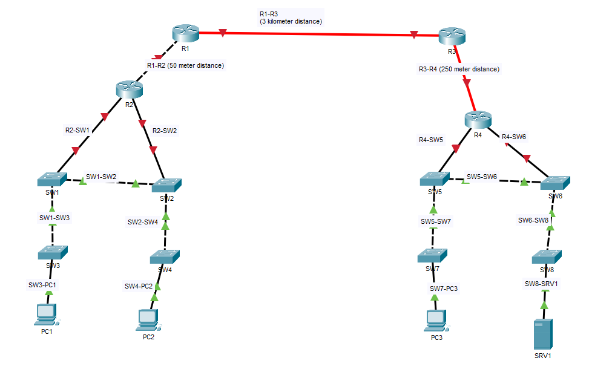

# Lab 02 - Connecting Devices

## Objective

Connect the network devices together according to the labels.
Use the appropriate type of cable, selecting each connection manually.

Assume **Auto MDI-X is disabled or unsupported**. Packet Tracer does not differentiate between single-mode and multimode fiber, but identify which type is appropriate for each fiber link.

## Topology

- **Left side:** R1 connects to R2; R2 connects to SW1 and SW2. SW1 connects to SW2 and SW3; SW2 connects to SW4. PC1 connects to SW3 and PC2 connects to SW4.
- **Right side:** R3 connects to R4; R4 connects to SW5 and SW6. SW5 connects to SW6 and SW7; SW6 connects to SW8. PC3 connects to SW7 and SRV1 connects to SW8.
- **Between sides:** R1 connects to R3 over a distance of 3 km.

## Required Devices

| Device | Labels  | Quantity |
| ------ | ------- | -------- |
| Router | R1-R4   | 4        |
| Switch | SW1-SW8 | 8        |
| PC     | PC1-PC3 | 3        |
| Server | SRV1    | 1        |

The screenshot does not specify models or port numbers. Choose devices with enough Ethernet interfaces and compatible fiber ports/modules for R1-R3 and R3-R4.

## Cable Selection

With Auto MDI-X disabled, router and PC/server Ethernet ports are normally **MDI**, while switch ports are normally **MDI-X**. Use straight-through copper between MDI and MDI-X ports, and cross-over copper between ports of the same type. Standard copper Ethernet channels have a **100 m** limit.

Treat links without distance labels as local links within copper reach.

| Link label | Distance | Packet Tracer cable     | Reason / intended fiber type                                        |
| ---------- | -------- | ----------------------- | ------------------------------------------------------------------- |
| R1-R2      | 50 m     | Copper Cross-Over       | Router to router; within copper reach.                              |
| R1-R3      | 3 km     | Fiber                   | **Single-mode** with optics rated for at least 3 km.                |
| R3-R4      | 250 m    | Fiber                   | **Multimode** with optics and fiber grade rated for at least 250 m. |
| R2-SW1     | Local    | Copper Straight-Through | Router to switch.                                                   |
| R2-SW2     | Local    | Copper Straight-Through | Router to switch.                                                   |
| R4-SW5     | Local    | Copper Straight-Through | Router to switch.                                                   |
| R4-SW6     | Local    | Copper Straight-Through | Router to switch.                                                   |
| SW1-SW2    | Local    | Copper Cross-Over       | Switch to switch.                                                   |
| SW1-SW3    | Local    | Copper Cross-Over       | Switch to switch.                                                   |
| SW2-SW4    | Local    | Copper Cross-Over       | Switch to switch.                                                   |
| SW5-SW6    | Local    | Copper Cross-Over       | Switch to switch.                                                   |
| SW5-SW7    | Local    | Copper Cross-Over       | Switch to switch.                                                   |
| SW6-SW8    | Local    | Copper Cross-Over       | Switch to switch.                                                   |
| SW3-PC1    | Local    | Copper Straight-Through | Switch to PC.                                                       |
| SW4-PC2    | Local    | Copper Straight-Through | Switch to PC.                                                       |
| SW7-PC3    | Local    | Copper Straight-Through | Switch to PC.                                                       |
| SW8-SRV1   | Local    | Copper Straight-Through | Switch to server.                                                   |

**Total: 17 links — 8 copper straight-through, 7 copper cross-over, and 2 fiber.**

## Procedure

1. Place the required devices in the Packet Tracer workspace.
2. Arrange and label them to match the reference diagram.
3. Ensure R1 and R4 each have at least one compatible fiber interface and R3 has two. If modules are needed, power off the device in the **Physical** tab before installation, then power it on again.
4. Open **Connections** and manually select **Copper Straight-Through**, **Copper Cross-Over**, or **Fiber** for each link in the table. Avoid **Automatically Choose Connection Type** for this exercise.
5. Select available compatible Ethernet ports at both ends. The screenshot does not prescribe interface numbers.
6. Add the distance labels: R1-R2 (50 m), R1-R3 (3 km), and R3-R4 (250 m).
7. Review all 17 links against the table and save the topology as a `.pkt` file.

## Scope and Review

This lab covers device placement and physical connections. IP addressing, routing, firewall configuration, and ping tests are not required by the supplied instructions.

Review device quantities, labels, endpoints, and cable types against the diagram and connection table.

- Confirm that both long links use fiber and document their intended fiber types.
- Red indicators do not by themselves prove incorrect cabling. Router interfaces may be administratively shut down; check interface status and use `no shutdown` on the relevant interface if bringing the link up.
- Allow switch ports time to initialize. A green physical link alone does not prove end-to-end IP connectivity.

The reference screenshot includes red link indicators. No completed `.pkt` file or live connectivity test is included in this folder yet.

## Files

- [Topology screenshot](topology02.png)

## Lessons Learned

- Select straight-through and cross-over copper cables without relying on Auto MDI-X.
- Account for the 100 m copper Ethernet channel limit.
- Choose single-mode or multimode fiber based on distance and supported optics.
- Distinguish correct physical cabling from interface state and IP connectivity.
